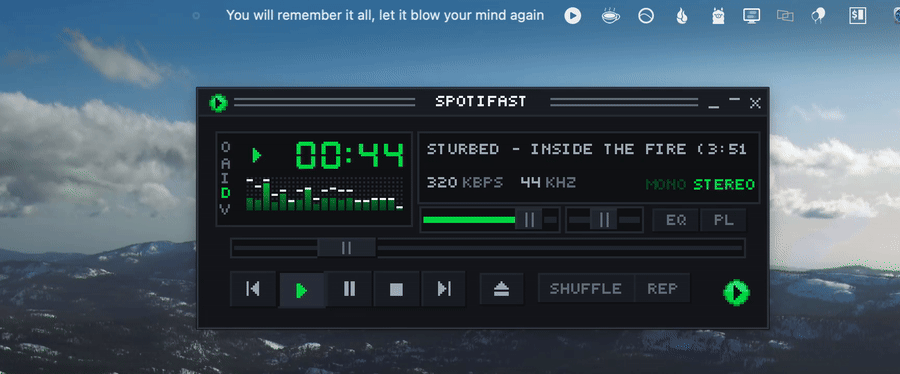

# SpotifastLyrics

Synced lyrics in your macOS menu bar, line by line, for [Spotifast](https://spotifast.rocks) (or any app that shows up in macOS Now Playing).



[Watch the demo as MP4](docs/demo.mp4)

## Features

- Shows the line being sung right now in the menu bar
- Click it to see the full lyrics, with the current line checked
- Falls back to "Title — Artist" when a song has no timed lyrics
- Timing offset if lyrics feel early or late
- Adjustable max width
- Follows Spotifast only by default, or any player (Apple Music, Spotify, browsers, VLC, …)
- Launch at login
- Small and native: one Swift file, no dependencies, no Xcode project

Lyrics come from [LRCLIB](https://lrclib.net), a free, open lyrics database.

## Install

### Download

1. Download **SpotifastLyrics.zip** from the [latest release](https://github.com/kshitijsriv/SpotifastLyrics/releases/latest) and unzip it.
2. Drag **SpotifastLyrics.app** into your Applications folder.
3. Open it. macOS will say it can't verify the app, because it isn't signed with a paid Apple Developer certificate. To allow it, either:
   - open **System Settings → Privacy & Security**, scroll down and click **Open Anyway** next to SpotifastLyrics, or
   - run this in Terminal:
     ```sh
     xattr -dr com.apple.quarantine /Applications/SpotifastLyrics.app
     ```

You only need to do this once. The app runs on Apple Silicon and Intel Macs with macOS 13 or later. Look for ♪ in your menu bar.

### Build from source

You need the Xcode command line tools (`xcode-select --install`).

```sh
git clone https://github.com/kshitijsriv/SpotifastLyrics.git
cd SpotifastLyrics
./build.sh --install
```

This builds `SpotifastLyrics.app`, copies it to `/Applications` and launches it. `./build.sh` alone only builds into `build/`, and `./build.sh --zip` also makes the release zip.

## How it works

Apple restricted the private MediaRemote framework in macOS 15.4, so most apps can no longer read what's playing. `osascript` is still allowed, so a small JavaScript-for-Automation helper (`Sources/nowplaying.js`) reads Now Playing every half second and prints a JSON line when something changes. The app works out the current position from the last reported elapsed time, fetches lyrics from LRCLIB and updates the menu bar five times a second.

Because this relies on a private framework, a future macOS update could break it.

## Limitations

- Browser playback (YouTube etc.) often has messy titles like "Artist - Song (Official Video)", so lyrics may not be found.
- Players that don't report playback position will drift.

## License

MIT. Not affiliated with Spotify or Spotifast.
